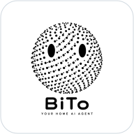

<p align="center"></p>

# BiTo

[Download source (main ZIP)](https://github.com/frankrainrp/BiTo-P/archive/refs/heads/main.zip) · [Demo walkthrough](docs/DEMO.md)

BiTo is an AI agent for personal and household assistance. It helps users set up tasks on a private server and manage everyday affairs with less repetitive work. The project is designed to learn users' routines over time through separately configured cameras and background activity monitoring.

An independent personal project, designed and developed by Feng Kaiduo.

This public repository contains the server component and a demo using fictional household records. The full household interface and camera integrations are maintained separately.

**Python · SQLite · HTTP APIs · Docker · GitHub Actions**

[Windows API and source downloads](https://github.com/frankrainrp/BiTo-P/releases/tag/v0.1.0) · [Component guide](docs/DISTRIBUTION.md) · [Engineering](docs/ENGINEERING.md)

## Implementation

| Capability | Mechanism | Source |
|---|---|---|
| Household planning | Ownership and visibility checks around transactional task, event and habit operations | [Life services](familyos/life.py), [member context](familyos/member_context.py) |
| AI-assisted changes | Allow-listed schemas, member-bound proposals, explicit confirmation and execution records | [Assistant](familyos/companion.py), [actions](familyos/companion_actions.py) |
| Persistent state | SQLite foreign keys, WAL and 24 schema migrations | [Database](familyos/db.py), [migrations](migrations) |
| Conversations and jobs | Member-scoped chat history, bounded work, cancellation and recovery states | [Chat history](familyos/chat_history.py), [jobs](familyos/agent_jobs.py) |
| Activity processing | Local redaction, structured ingestion, deterministic statistics and optional model summaries | [Collector](agents/windows_activity/collector.py), [activity](familyos/activity.py) |
| Scheduled work | Trigger previews, deduplication, cooldowns and validated destinations | [Scheduling](familyos/agent_schedule.py), [monitoring](familyos/monitoring.py) |
| Delivery | Regression tests, a synthetic-data HTTP demo and container health checks | [Tests](tests), [CI](.github/workflows/verify.yml) |

## Run the demo

Requires Python 3.12+:

```sh
git clone https://github.com/frankrainrp/BiTo-P.git
cd BiTo-P
python -m venv .venv
```

Activate `.venv`, then run:

```sh
python -m pip install -r requirements-dev.txt
python examples/demo.py
```

The demo starts an isolated API, creates fictional members and records, and checks persistence and member visibility. For Windows, extract the API package and run `Run-Demo.cmd` using the included Python runtime.

## Run the API

```sh
docker compose up --build -d
curl http://127.0.0.1:8080/api/health
```

The persistent Windows entry point is `Start-Server.cmd`. Its database is created in `data/familyos.db`.

## Model and client integration

Ollama and OpenAI-compatible endpoints are configured server-side. The model is selected by deployment settings; deterministic planning and statistics execute in Python. This API edition includes a synthetic HTTP review client. The separate BiTo deployment adds the household application interface and configured speech/model services.

Username-based identity is intended for a trusted local environment. The default API and Docker listener bind to loopback. Production household data, credentials, model weights and the production UI are maintained separately.

## Verification

```sh
python -m unittest discover -s tests -v
python examples/demo.py
```

[Agent instructions](AGENTS.md) · [Security model](SECURITY.md) · [Third-party notices](THIRD_PARTY_NOTICES.md)
