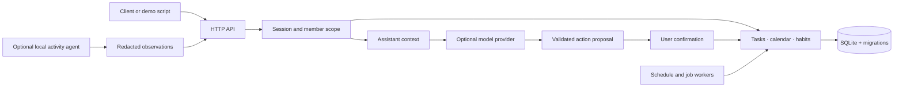

# FamilyOS

**A local-first household coordination platform, with AI actions that remain under the user's control.**

[](https://github.com/frankrainrp/FamilyOS-Showcase/actions/workflows/verify.yml)

Python · SQLite · HTTP APIs · Docker · GitHub Actions

FamilyOS connects household tasks, calendars, habits and personal activity summaries. Its assistant can read a member's permitted context and propose changes; the application validates ownership and requires confirmation before executing model-proposed writes.

This is the **public API and engineering showcase** of a home-server project. It includes runnable domain services, 24 SQL migrations, regression tests and a synthetic-data demo. The production UI package, household data, model weights and private deployment configuration are not part of this edition.

**For a quick review:** run the [demo](examples/demo.py), read the [engineering walkthrough](docs/ENGINEERING.md), then inspect the [AI action boundary](familyos/companion_actions.py) and [HTTP integration tests](tests/test_http.py). [中文介绍](docs/README.zh-CN.md)

## The problem

A shared task list becomes more useful when it knows whose task it is, whether another member may see it, and what a proposed assistant action would change. FamilyOS makes those rules explicit in its data model and service layer. Core planning works without an LLM or external cloud service.

## What the code demonstrates

| Capability | Implementation | Evidence to inspect |
|---|---|---|
| Member-scoped tasks, events and habits | Household ownership and visibility checks around SQLite transactions | [Life services](familyos/life.py), [tests](tests/test_life.py) |
| Confirm-before-write AI actions | Allow-listed tool schemas become member-bound proposals; confirmation executes a validated domain operation | [Action service](familyos/companion_actions.py), [tests](tests/test_companion.py) |
| Persistent chat and bounded agent jobs | Conversation ownership, job states, cancellation and execution records | [Chat history](familyos/chat_history.py), [job tests](tests/test_agent_jobs.py) |
| Private activity summaries | Optional local capture pipeline; server rejects raw screenshot fields and accepts redacted observations | [Ingestion](familyos/activity.py), [tests](tests/test_activity.py) |
| Scheduled work and source monitoring | Schedule previews, cooldowns, deduplication and destination validation | [Schedule tests](tests/test_agent_schedule.py), [monitor tests](tests/test_monitoring.py) |
| Reproducible delivery | Dependency-pinned checks, synthetic HTTP demo and an isolated container smoke test | [CI workflow](.github/workflows/verify.yml) |

## Download

[Windows API bundle and source package](https://github.com/frankrainrp/FamilyOS-Showcase/releases/tag/v0.1.0) · [Server/client component guide](docs/DISTRIBUTION.md) · [Planned illustration brief](docs/DIAGRAM_BRIEF.md)

The Windows bundle includes Python: extract it and run `Run-Demo.cmd` for a fictional-data review, or `Start-Server.cmd` for a persistent loopback API. The public edition has no production browser UI.

## Try it in two minutes

Requires Python 3.12 or newer. Run from the repository root:

```sh
git clone https://github.com/frankrainrp/FamilyOS-Showcase.git
cd FamilyOS-Showcase
python -m venv .venv
# macOS/Linux:
source .venv/bin/activate
# Windows PowerShell: .venv\Scripts\Activate.ps1
python -m pip install -r requirements-dev.txt
python examples/demo.py
```

The demo starts a temporary loopback server and uses the real HTTP API. It creates two fictional members, verifies that a shared task is visible while a private task is hidden, completes a task, checks persistence, and rejects a request without a session. It needs no GPU, API key, household server or browser. Temporary data is removed on exit.

Expected output, alongside HTTP request logs:

```text
PASS  Household initialized through the HTTP API
PASS  Second member sees the shared task, not the private task
PASS  Task completion persisted in SQLite
PASS  Request without a session rejected with HTTP 401
```

To keep an API instance running locally:

```sh
docker compose up --build -d
curl http://127.0.0.1:8080/api/health
docker compose down
```

The Compose service binds to **127.0.0.1** and retains its database in a Docker volume. It does not require external Docker networks, voice containers or model downloads. `python -m familyos` is also available for local development.

## Architecture



A modular monolith keeps deployment and recovery manageable on one household machine. The domain services own validation and persistence; model output does not grant permissions. SQLite uses foreign keys, WAL mode and explicit transactions. See [design choices and tradeoffs](docs/ENGINEERING.md).

## Verification

```sh
python -m unittest discover -s tests -v
python examples/demo.py
```

CI repeats these checks on Ubuntu/Python 3.12, validates Compose, builds the Docker image and checks health inside a container with networking disabled. Model-dependent tests use controlled transports rather than paid inference. Tests cover the public API edition; they do not establish browser accessibility, live speech quality or performance under large-scale load.

## Runtime boundary

The current sign-in flow selects an existing username inside a trusted local environment. **It is not internet-grade identity verification.** Session-scoped authorization is implemented, but it cannot prevent someone who knows another username from signing in as that member. Keep this edition on loopback; an internet-facing service needs a stronger identity provider and a separate deployment review. See [SECURITY.md](SECURITY.md).

Model, speech and household-source integrations are optional. Home Assistant device execution, arbitrary remote tools and a public hosted demo are not claimed as delivered here. The repository intentionally starts with a clean public history and has no deployment connection to the private household installation.

## Repository map

```text
familyos/      HTTP boundary, domain services and workers
migrations/    Versioned SQLite schema changes
agents/        Optional Windows activity processing source
tests/         Domain and HTTP integration regressions
examples/      Reproducible, synthetic-data HTTP demo
docs/          Engineering walkthrough and Chinese overview
```

This is a source-available portfolio snapshot. Bundled code does not grant rights to excluded interface assets or model weights. Dependency acknowledgements are in [THIRD_PARTY_NOTICES.md](THIRD_PARTY_NOTICES.md).
