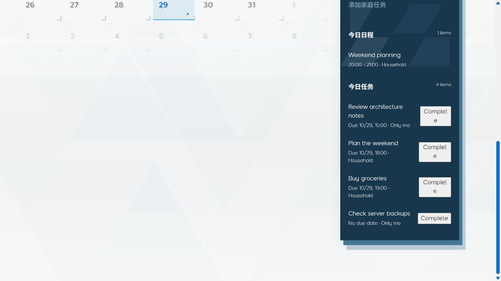

# BiTo recorded walkthrough and public API demo

[Download source from main](https://github.com/frankrainrp/BiTo-P/archive/refs/heads/main.zip)

## Watch the recorded walkthrough

This 13-second recording shows the separately maintained full BiTo household application with fictional data. The public source ZIP contains the Python/SQLite API and a synthetic HTTP demo; the household interface shown here is maintained separately. English mode is selected in the recording; some original labels remain in Chinese.

[](assets/bito-real-page-demo.mp4)

[Watch MP4](assets/bito-real-page-demo.mp4) · [Download MP4](https://raw.githubusercontent.com/frankrainrp/BiTo-P/main/docs/assets/bito-real-page-demo.mp4) · [English captions](assets/bito-real-page-demo.en.vtt)

## Recorded steps

1. Open **Calendar** in the full BiTo application.
2. Expand the household task form and enter **Check server backups** as the title.
3. Select the form's **Add** button. The saved task appears in today's task list.
4. Reload the browser page. The same task remains in today's list.

The saved task remains open and private. The clip shows a manual save-and-reload flow; it does not show a scheduler execution or an AI response.

## Run the bundled public API demo

Use Python 3.12 or newer. After extracting the ZIP, open a terminal in `BiTo-P-main`:

```sh
python -m venv .venv
```

Activate the environment on Windows:

```powershell
.venv\Scripts\Activate.ps1
```

On macOS or Linux:

```sh
source .venv/bin/activate
```

Install the demo dependencies and run the included client:

```sh
python -m pip install -r requirements-dev.txt
python examples/demo.py
```

The client starts a temporary local API, creates fictional household records, checks the results, and removes its temporary database on exit. It does not call a model or an external service.

## Follow one household task

The walkthrough uses the real HTTP operations in the bundled client:

1. Create a demo household for **Alex** and add **Sam** as another member.
2. Alex creates **Review architecture notes** as a private task and **Plan the weekend** as a shared task.
3. Sam's active-task response includes the shared task and excludes Alex's private task.
4. Alex completes **Review architecture notes** through its completion endpoint.
5. The SQLite row retains the task with status `completed`; the active-task response no longer includes it.

An unauthenticated request to the active-task endpoint is also checked and returns HTTP `401`.

## The browser page

The public package includes a small API information page and a health endpoint. Its runnable review client is `examples/demo.py`. The private BiTo application and its household interface remain separate from this public repository.

## Source references

- [Bundled HTTP demo](https://github.com/frankrainrp/BiTo-P/blob/main/examples/demo.py)
- [HTTP server](https://github.com/frankrainrp/BiTo-P/blob/main/familyos/http.py)
- [Task services](https://github.com/frankrainrp/BiTo-P/blob/main/familyos/life.py)
- [Database and migrations](https://github.com/frankrainrp/BiTo-P/blob/main/familyos/db.py)
- [Delivered components](https://github.com/frankrainrp/BiTo-P/blob/main/docs/DISTRIBUTION.md)
