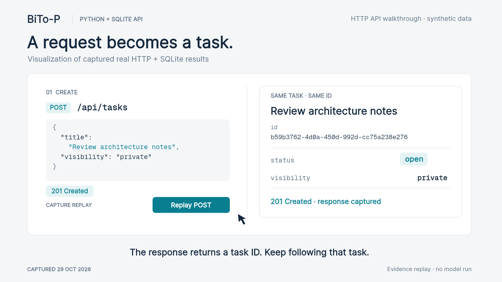

# BiTo-P API walkthrough

[Download source from main](https://github.com/frankrainrp/BiTo-P/archive/refs/heads/main.zip)

[](assets/bitop-task-demo.mp4)

[Watch or download the 23-second video](https://github.com/frankrainrp/BiTo-P/raw/refs/heads/main/docs/assets/bitop-task-demo.mp4)

## Run the bundled demo

Use Python 3.12 or newer. After extracting the ZIP, open a terminal in `BiTo-P-main`:

```sh
python -m venv .venv
```

Activate the environment on Windows:

```powershell
.venv\Scripts\Activate.ps1
```

On macOS or Linux:

```sh
source .venv/bin/activate
```

Install the demo dependencies and run the included client:

```sh
python -m pip install -r requirements-dev.txt
python examples/demo.py
```

The client starts a temporary local API, creates fictional household records, checks the results, and removes its temporary database on exit. It does not call a model or an external service.

## Follow one household task

The walkthrough uses the real HTTP operations in the bundled client:

1. Create a demo household for **Alex** and add **Sam** as another member.
2. Alex creates **Review architecture notes** as a private task and **Plan the weekend** as a shared task.
3. Sam's active-task response includes the shared task and excludes Alex's private task.
4. Alex completes **Review architecture notes** through its completion endpoint.
5. The SQLite row retains the task with status `completed`; the active-task response no longer includes it.

An unauthenticated request to the active-task endpoint is also checked and returns HTTP `401`.

## What the video shows

The video visualizes captured HTTP responses and the resulting SQLite record from an actual synthetic run. It follows the same task through `POST /api/tasks`, its completion endpoint, and the stored row. The workbench graphics explain that captured result; they are not a bundled household dashboard or a live AI response.

## The browser page

The public package includes a small API information page and a health endpoint. Its runnable review client is `examples/demo.py`. The private Bito application and its household interface remain separate from this public repository.

## Source references

- [Bundled HTTP demo](https://github.com/frankrainrp/BiTo-P/blob/main/examples/demo.py)
- [HTTP server](https://github.com/frankrainrp/BiTo-P/blob/main/familyos/http.py)
- [Task services](https://github.com/frankrainrp/BiTo-P/blob/main/familyos/life.py)
- [Database and migrations](https://github.com/frankrainrp/BiTo-P/blob/main/familyos/db.py)
- [Delivered components](https://github.com/frankrainrp/BiTo-P/blob/main/docs/DISTRIBUTION.md)
